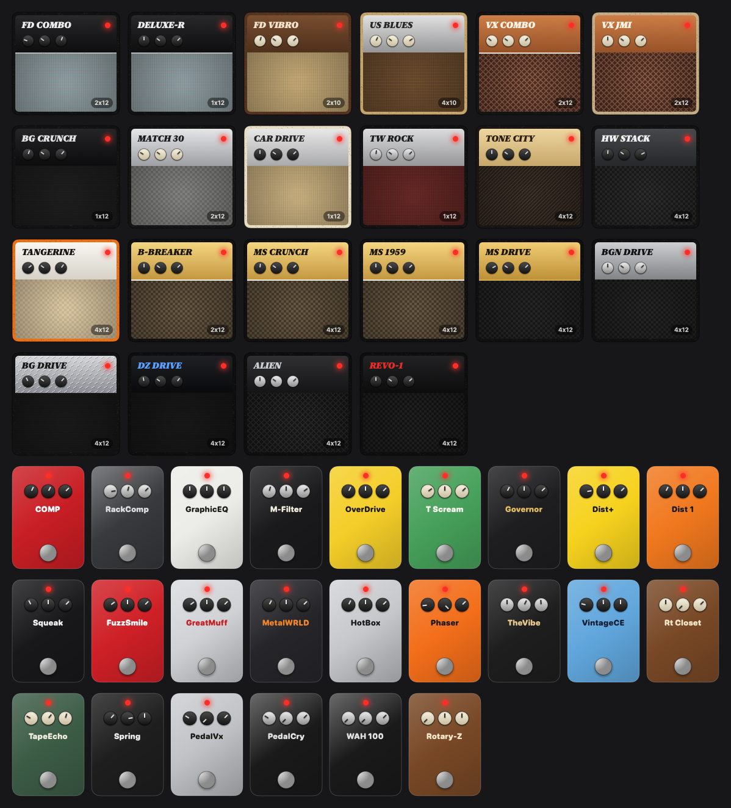

# G5 Editor

Version 0.2.1 · see [CHANGELOG.md](CHANGELOG.md)

**A Zoom G5 editor for modern macOS: a free, open-source alternative to Zoom Edit&Share.** It runs on macOS 14 Sonoma, 15 Sequoia and later, on Apple Silicon (M1–M4) and Intel Macs. It is for the original **ZOOM G5** guitar multi-effects pedal, not the G5n.

Zoom's own *Edit&Share* app is a 32-bit Intel program, so it no longer runs on modern Macs, not even under Rosetta. G5 Editor replaces it: edit patches, back up and restore all 297 patches as `.syx`, tune, and hear the G5's USB audio through your Mac. It talks to the pedal over USB MIDI, and the pedal is class-compliant, so no driver is needed.


## Download & install
1. Download **`G5-Editor-<version>.dmg`** from the [latest release](https://github.com/andik6/G5Editor/releases/latest).
2. Open it and drag **G5 Editor** onto **Applications**.
3. **First launch:** the app isn't signed with an Apple Developer ID, so macOS blocks it the first time.
   - **macOS 15 Sequoia and later:** try to open it once, then go to **System Settings → Privacy & Security**, scroll down and click **Open Anyway**.
   - **macOS 14 Sonoma:** right-click (Control-click) the app, choose **Open**, then **Open** again.
4. Connect the G5 by USB. When macOS asks for **microphone** access, allow it. The app uses it only to hear the G5's USB audio for the monitor and the tuner; nothing is recorded or sent anywhere.
5. Click **Back Up** before you start editing.

Runs on macOS 14 or later, on both Apple Silicon and Intel Macs.

## Features

### Visual patch editor
- All 297 patches are listed in the sidebar, grouped into 99 banks that open and close (click a bank row to open or close it; ⌥-click or **Expand All** for all of them, ← / → for the bank of the selected patch). A closed bank shows its three patch names, or the song title if the Sound Patcher wrote it. The bank you're playing opens by itself. You can search by patch name, song title or effect name ("Delay", "MS 1959"…).
- Selecting a patch switches the pedal to it.
- The signal chain is drawn as stompboxes and amp heads, colour-coded by category:
  - **Click** a footswitch to turn an effect on or off.
  - **Drag** a pedal to reorder the chain.
  - **Double-click** a pedal to swap it for another effect.
- **Knobs:** drag to turn them, or double-click one to type an exact value. Mode-type parameters are drop-down menus.
- **Effect & amp browser:** every G5 effect and amp, grouped by category and searchable. Amps show the real amp and cabinet they model.
- **Patch settings:** name (10 characters), patch level and control-switch assignment, plus **Revert** and **Save to Pedal**.
- Edits play on the pedal live. The G5 auto-saves edit-buffer changes to the active patch after about 5 seconds, the same as turning its own knobs.
- Changes you make on the pedal itself, including patch switches, show up in the app within about 2 seconds.

### AI Sound Patcher
- Toolbar ✨ button or ⇧⌘P opens a chat panel. Ask for a song ("Gravity by John Mayer: clean, rhythm and solo") and the AI fills the chosen bank with three patches. Follow-ups ("make the clean brighter") change the bank that's on the pedal now.
- The AI researches the guitarist's gear and the song's tempo on the web (for delay times) and lists its sources. It doesn't hear the recording, so treat the result as a starting point and tune by ear.
- You see a preview first. **Write to Bank** backs up all patches, writes the three, verifies them, and can be undone.
- **Requires [Claude Code](https://claude.com/claude-code)** installed and logged in on the Mac. It runs on your own Claude subscription (Pro or Max), with no extra charge from this app. Without Claude Code the panel just explains how to set it up; the rest of the app works as before.

### Backup & restore
- **Back Up Now** (⌘B) reads all 297 patches into a standard `.syx` file in `~/Documents/G5 Backups/`.
- The backup browser shows each patch's effect chain and marks patches that differ from what's on the pedal.
- You can restore selected patches or everything. A safety backup is taken automatically before any restore.
- **Import Backup…** (⌘I) opens `.syx` files from elsewhere.
- Every write is verified by reading the patch back. Each SysEx message carries a CRC-32 checksum that the pedal checks.

### Real-gear looks
- Each amp is drawn in the colours of the amp it models: tolex, control panel and grille cloth (blackface Fender, Vox diamond grille, gold-panel Marshall, Orange, Mesa diamond plate…).
- Pedals modelled on a known stompbox use that pedal's colours (TS-style green, DS-style orange, Big Muff silver…).
- Only colours are used, no logos. Everything else keeps its category colour.



### Tuner
- Chromatic tuner reading the G5's USB audio: toolbar tuning-fork button or ⇧⌘T.
- Shows a needle (±50 cents), the note and octave, frequency, and highlights the matching string in standard tuning.
- A4 can be set from 435 to 445 Hz. Optionally mutes the monitor while tuning.
- Uses two-pass YIN pitch detection. On synthetic test tones from B1 to E6 it is accurate to within 0.7 cents.

### Monitor: hear the G5 through the Mac
- Plays the G5's USB audio (guitar plus effects) through any audio output on the Mac, such as a USB sound card, the Mac speakers or a monitor. No extra cables or headphones on the pedal are needed.
- Converts the sample rate (the G5 runs at 44.1 kHz; most interfaces run at 48 kHz) and corrects for clock drift. Delay from the G5 to the speakers is about **9 ms** at the default **Low** latency setting. Choose **Normal** or **Safe** in the sidebar if you hear clicks.
- Toolbar button or ⇧⌘M; output picker, volume and level meter are in the sidebar.
- For listening on speakers or headphones, set the G5's **GLOBAL → OUTPUT** to **DIRECT**. The setting also changes the USB signal, and COMBO/STACK modes sound wrong on full-range speakers.
- Remembers its last state, and turns itself back on when the app starts or the pedal is plugged in again.
- **Reconnects by itself** if audio stops, a device is unplugged and re-plugged, a sample rate changes, or the Mac wakes from sleep.
- **Volume up to +12 dB with a limiter.** 0 dB plays the G5 at its own level, which is quieter than mastered music; around +6 to +9 dB matches a YouTube track. A peak limiter keeps the output from clipping, and a **LIMIT** light shows when it works.
- **Clip warning:** the meter's dot turns red when the G5's own output clips, with a hint to lower MASTER LEVEL or the patch level.
- **Tip:** compare against other audio on the *same* output. The Mac's built-in speakers are much quieter than an interface or monitor speakers, and add about 17 ms of delay.

## Requirements
- macOS 14 Sonoma or later
- A ZOOM G5 connected by USB and switched on (firmware 1.20 was tested)
- To build: Swift 6 toolchain. The Xcode Command Line Tools are enough; full Xcode isn't needed.

## Build & run

```sh
./build-app.sh                 # release build for this Mac → dist/G5 Editor.app (ad-hoc signed)
./build-app.sh --universal     # Apple Silicon + Intel
./make-dmg.sh                  # universal build packed as dist/G5-Editor-<version>.dmg
open "dist/G5 Editor.app"
```

To install a local build, copy `dist/G5 Editor.app` to `/Applications`.

## Safety notes
- **Back up before editing.** One click, and it lets you undo anything.
- The pedal auto-saves edits to the patch you are editing. **Revert** restores the patch as it was when you opened it, both on the pedal and in memory.
- Each G5 patch has one **Z-Pedal slot**. It only holds Z-Pedal effects (or ZP-None), and Z-Pedal effects only fit there. The effect browser follows this rule, and the app tells you if the pedal rewrites an effect anyway.

## Known limitations
- **Tempo-synced values:** the note names (delay times or rates set to note values) come from Zoom's other pedals and haven't been checked on the G5's display.
- **Z-Pedal "CUSTOM":** the pedal-range settings can't be edited yet.
- **Descriptions:** only about 30 effects have one.
- **Drums:** the G5 doesn't send its rhythm patterns over USB, so the monitor can't play them.
- **Tuner:** tested with synthetic tones; testing with a real guitar is still pending.

## Project layout

| Path | What's there |
|---|---|
| `Sources/G5Core` | Pedal protocol and data model: MIDI connection, SysEx, 7-bit packing, patch bit layout, CRC, backups, effect catalog, audio monitor engine |
| `Sources/G5Editor` | SwiftUI app |
| `Sources/g5tool` | Command-line tool used to reverse-engineer and test the protocol |
| `tools/make_catalog.py`, `tools/embed_catalog.py` | Regenerate the effect catalog |
| `tools/make_icon.swift` | Draws the app icon (`Resources/AppIcon.png`) |
| `docs/PROTOCOL.md` | The G5 SysEx protocol and patch format, as worked out for this project |
| `docs/DEVELOPMENT.md` | Architecture, testing hooks, developer tools |

## License
G5 Editor is released under the [MIT License](LICENSE).

## Disclaimer
This is an independent project. It is not affiliated with or endorsed by ZOOM Corporation. "ZOOM" and "G5" are trademarks of ZOOM Corporation.

The effect catalog (effect names, parameter names and ranges, and short descriptions) was derived from Zoom's Edit&Share resources and the G5 operation manual for interoperability. No Zoom artwork or code is included.

Use at your own risk, and keep backups.
