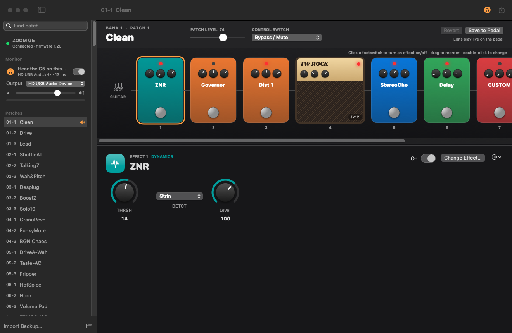

# G5 Editor

A native macOS app (Apple Silicon and Intel) for the **ZOOM G5** guitar multi-effects pedal: the original G5, not the G5n.

Zoom's own *Edit&Share* app is a 32-bit Intel program, so it no longer runs on modern Macs, not even under Rosetta. G5 Editor replaces it. It talks to the pedal over USB MIDI, and the pedal is class-compliant, so no driver is needed.



## Features

### Visual patch editor
- All 297 patches are listed in the sidebar by bank (for example `01-1 Clean`). You can search by patch name or by effect name ("Delay", "MS 1959"…).
- Selecting a patch switches the pedal to it.
- The signal chain is drawn as stompboxes and amp heads, colour-coded by category:
  - **Click** a footswitch to turn an effect on or off.
  - **Drag** a pedal to reorder the chain.
  - **Double-click** a pedal to swap it for another effect.
- **Knobs:** drag to turn them, or double-click one to type an exact value. Mode-type parameters are drop-down menus.
- **Effect & amp browser:** every G5 effect and amp, grouped by category and searchable. Amps show the real amp and cabinet they model.
- **Patch settings:** name (10 characters), patch level and control-switch assignment, plus **Revert** and **Save to Pedal**.
- Edits play on the pedal live. The G5 auto-saves edit-buffer changes to the active patch after about 5 seconds, the same as turning its own knobs.
- Changes you make on the pedal itself, including patch switches, show up in the app within about 2 seconds.

### Backup & restore
- **Back Up Now** (⌘B) reads all 297 patches into a standard `.syx` file in `~/Documents/G5 Backups/`.
- The backup browser shows each patch's effect chain and marks patches that differ from what's on the pedal.
- You can restore selected patches or everything. A safety backup is taken automatically before any restore.
- **Import Backup…** (⌘I) opens `.syx` files from elsewhere.
- Every write is verified by reading the patch back. Each SysEx message carries a CRC-32 checksum that the pedal checks.

### Monitor: hear the G5 through the Mac
- Plays the G5's USB audio (guitar plus effects) through any audio output on the Mac, such as a USB sound card, the Mac speakers or a monitor. No extra cables or headphones on the pedal are needed.
- Converts the sample rate (the G5 runs at 44.1 kHz; most interfaces run at 48 kHz) and corrects for clock drift. Round-trip delay is about **13 ms**.
- Toolbar button or ⇧⌘M; output picker, volume and level meter are in the sidebar.
- Remembers its last state, and turns itself back on when the app starts or the pedal is plugged in again.

## Requirements
- macOS 14 Sonoma or later
- A ZOOM G5 connected by USB and switched on (firmware 1.20 was tested)
- To build: Swift 6 toolchain. The Xcode Command Line Tools are enough; full Xcode isn't needed.

## Build & run

```sh
./build-app.sh                 # release build → dist/G5 Editor.app (ad-hoc signed)
open "dist/G5 Editor.app"
```

To install it, copy `dist/G5 Editor.app` to `/Applications`. The app is signed only ad-hoc, so on another Mac you may need to right-click it and choose **Open** the first time.

## Safety notes
- **Back up before editing.** One click, and it lets you undo anything.
- The pedal auto-saves edits to the patch you are editing. **Revert** restores the patch as it was when you opened it, both on the pedal and in memory.
- The G5 allows only **one Z-Pedal effect per patch**, and it may refuse an effect when it runs out of DSP power ("DSP FULL"). The app blocks the first case and tells you about the second.

## Known limitations
- **Tempo-synced values:** the note names (delay times or rates set to note values) come from Zoom's other pedals and haven't been checked on the G5's display.
- **Z-Pedal "CUSTOM":** the pedal-range settings can't be edited yet.
- **Descriptions:** only about 30 effects have one.
- **Drums:** whether the rhythm or looper sound is sent over USB (and so reaches the monitor) hasn't been confirmed.

## Project layout

| Path | What's there |
|---|---|
| `Sources/G5Core` | Pedal protocol and data model: MIDI connection, SysEx, 7-bit packing, patch bit layout, CRC, backups, effect catalog, audio monitor engine |
| `Sources/G5Editor` | SwiftUI app |
| `Sources/g5tool` | Command-line tool used to reverse-engineer and test the protocol |
| `tools/make_catalog.py`, `tools/embed_catalog.py` | Regenerate the effect catalog |
| `docs/PROTOCOL.md` | The G5 SysEx protocol and patch format, as worked out for this project |
| `docs/DEVELOPMENT.md` | Architecture, testing hooks, developer tools |

## Disclaimer
This is an independent project. It is not affiliated with or endorsed by ZOOM Corporation. "ZOOM" and "G5" are trademarks of ZOOM Corporation.

The effect catalog (effect names, parameter names and ranges, and short descriptions) was derived from Zoom's Edit&Share resources and the G5 operation manual for interoperability. No Zoom artwork or code is included.

Use at your own risk, and keep backups.
